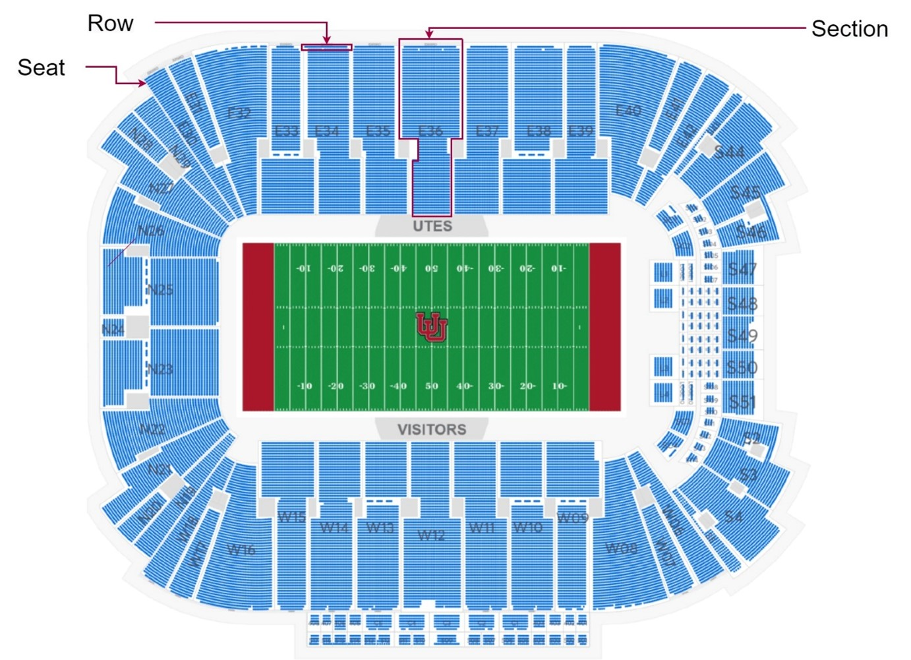
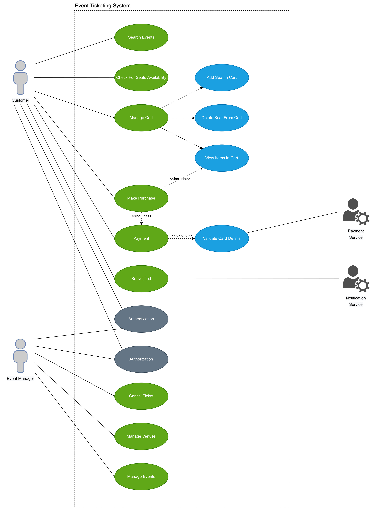
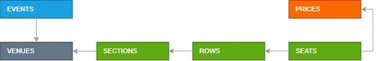
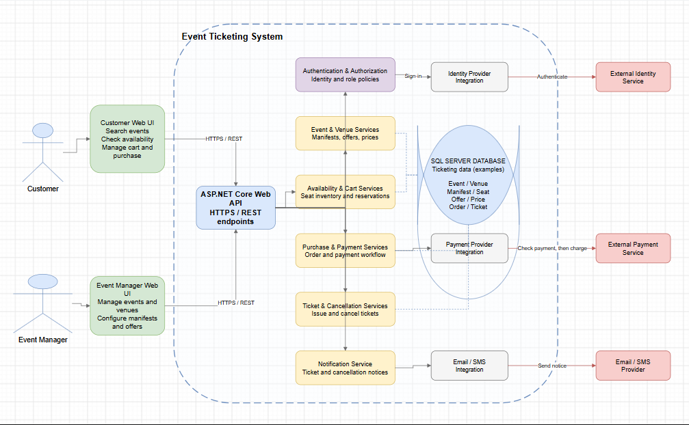
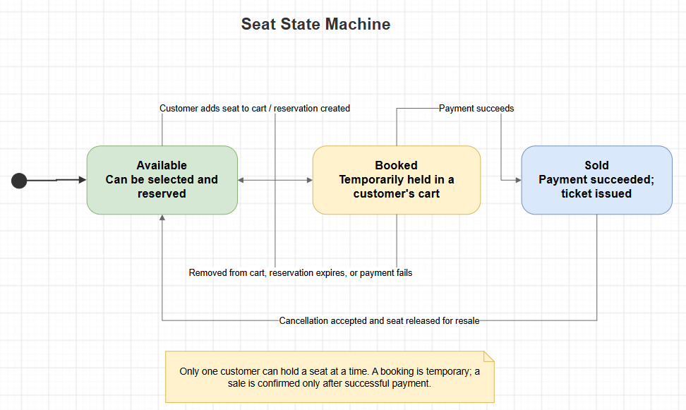
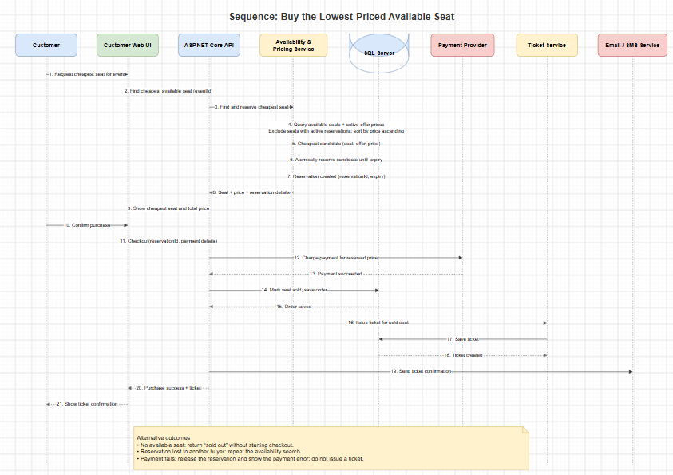

Domain Vocabulary:

**Event** – An event is an occurrence in time. In ticketing system, the event acts as a container for both venue (which holds inventory) and meta data about the event itself (name, venue, date, time).

**Venue** – the place where an event is happening.

**Manifest** – the seating arrangement applicable to a particular venue (complete seat map).

**Seat –** the smallest manifest unit that can be purchased or booked. The are two seat types - specific designated place in a row and general admission. General admission means patrons can choose to sit anywhere within a particular section (for example, the dance floor)

**Offer** – something you can buy and price for it. All seats in the ticketing system need to be sold through an offer. An offer is simply a configuration of properties that tell the system how the tickets should be sold

**Prices –** Information about the ticket price levels (Adult, Child, VIP, etc.)

**Ticket –** document (digital or printed), serving as evidence of admission price of some event. Tickets should include information about the event, the date and time of the event, venue and seats that have been paid for or booked.

**Customer –** an authenticated user who searches for tickets for an event of interest to him and buys a ticket through an online system

**Event Manager –** the user of the system who is responsible for administering the event (setting up the manifest, configuring the offer)

## Task 1: High-Level System Components

[Open the editable system components diagram in draw.io](./images/03-system-components.drawio)

The customer UI supports event search, seat availability, cart management, and purchases. The event manager UI supports venue and event administration, including manifests and offers. The ASP.NET Core API exposes these capabilities through application services, applies authentication and role-based authorization, and persists ticketing data in SQL Server. Payment and notification providers are external integrations; the system should confirm a successful payment before issuing tickets.

**Payment flow:** **Authorize** means the payment provider checks that the payment method can cover the purchase and may temporarily reserve the amount. **Capture** means asking the provider to collect that amount. A typical flow checks payment first, then charges after the order is accepted; tickets are issued only after the charge succeeds. Some providers combine these steps into one operation. The diagram's “Check payment, then charge” label summarizes this interaction.

**Reading the database symbol:** the cylinder represents one SQL Server database. The labels inside it are examples of the information the application stores, not separate servers or services: an **event** takes place at a **venue**; a **manifest** describes the venue's seating and **seats**; an **offer** defines what is sold and its **price**; an **order** records a customer's purchase; and a **ticket** is the admission document created for that purchase. The exact database tables and relationships would be designed during implementation.

## Task 2: Seat State Machine

 
[Open the editable seat state machine in draw.io](./images/04-seat-state-machine.drawio)

The diagram shows the lifecycle of one seat. It starts as **Available**. When a customer adds it to their cart, the system temporarily reserves it as **Booked** so another customer cannot buy it at the same time. If the customer removes it, the reservation expires, or payment fails, it returns to **Available**. Successful payment changes it to **Sold**. A sold seat returns to **Available** only if a cancellation is accepted and the seat is released for resale.

## Task 3: Buying the Lowest-Priced Available Seat

[Open the editable purchase sequence diagram in draw.io](./images/05-buy-lowest-priced-seat-sequence.drawio)

The customer asks for the cheapest available seat for an event. The system compares available seats and their active offer prices, then attempts to reserve the lowest-priced option before presenting it. If the customer confirms, payment is processed and a ticket is issued after successful payment. If another customer reserves the seat first, the system should search again; if payment fails, it releases the temporary reservation.

-   [Software Design: Modeling with UML](https://www.linkedin.com/learning/software-design-modeling-with-uml) (LinkedIn, 1h 40m)
-   [Use Case Diagram Relationships](https://creately.com/blog/diagrams/use-case-diagram-relationships/) (reading, 15m)
-   [Sequence Diagram Tutorial](https://creately.com/blog/diagrams/sequence-diagram-tutorial/) (reading, 9m) 